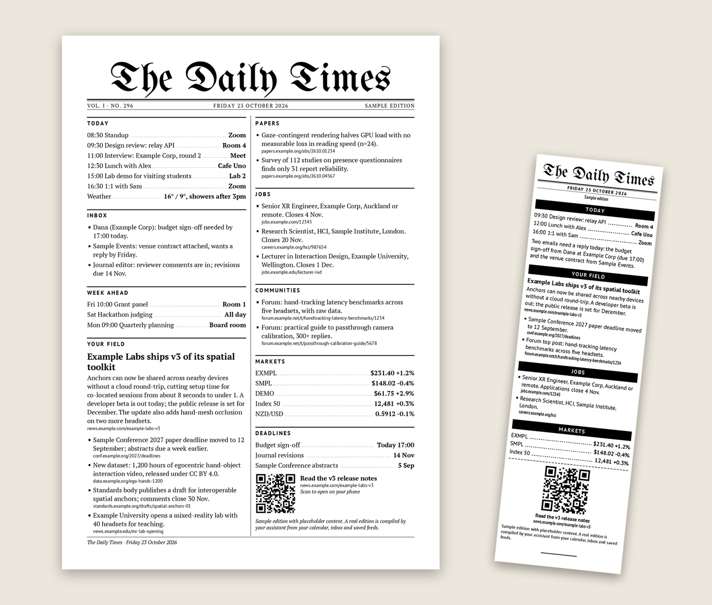
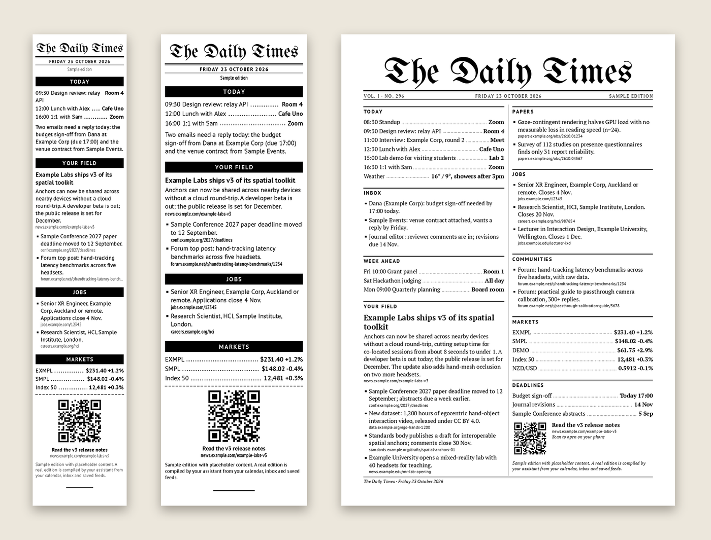
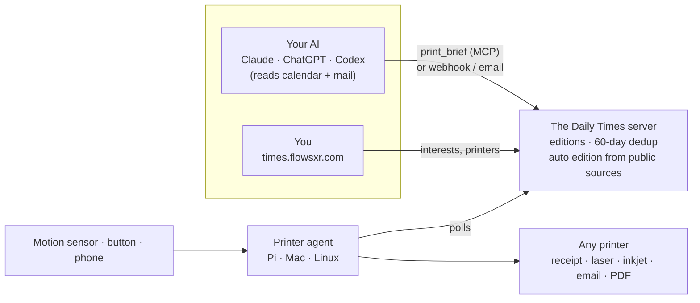
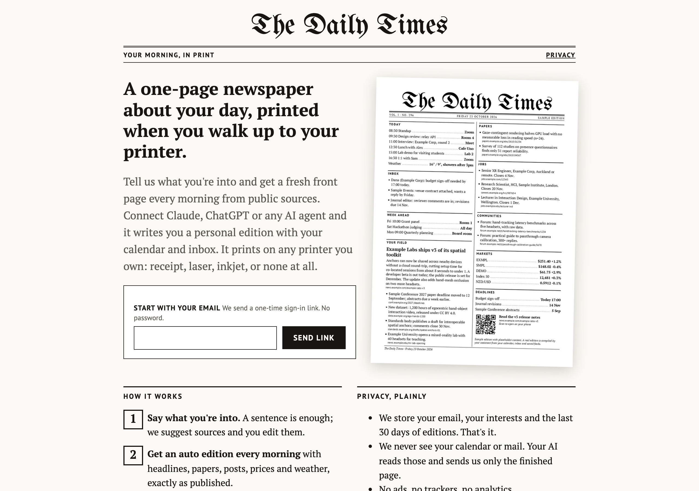
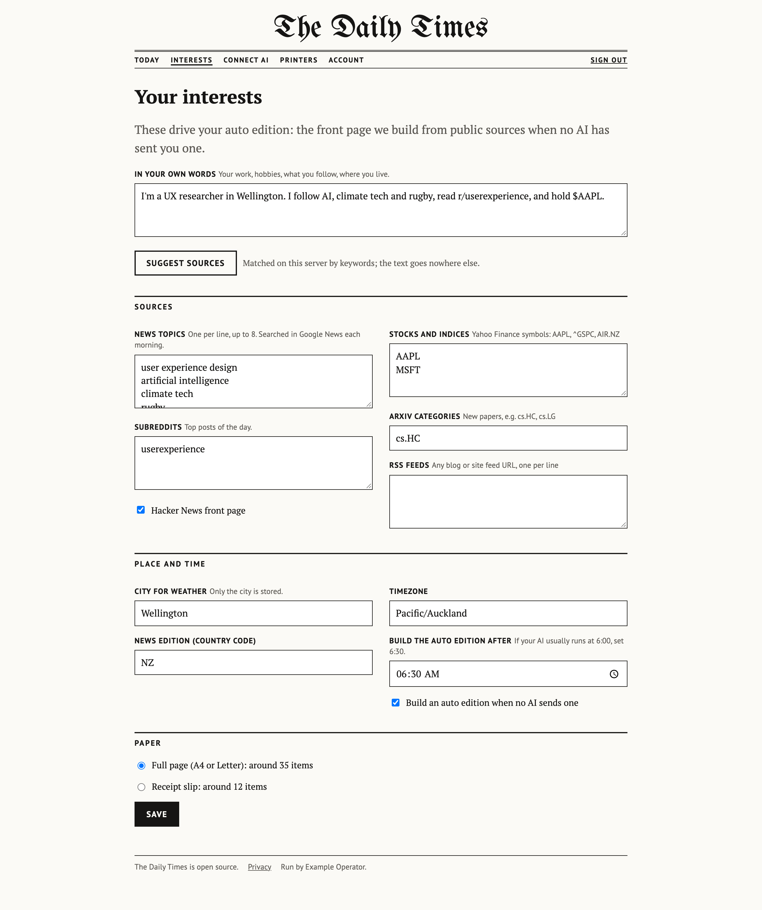
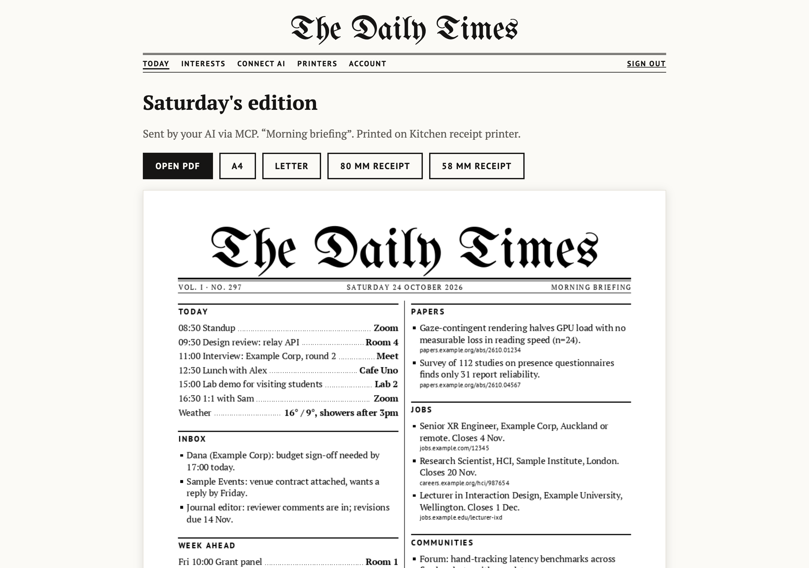
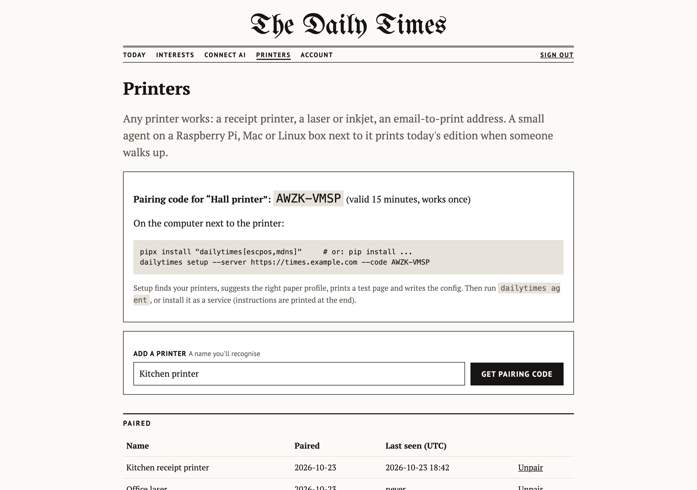
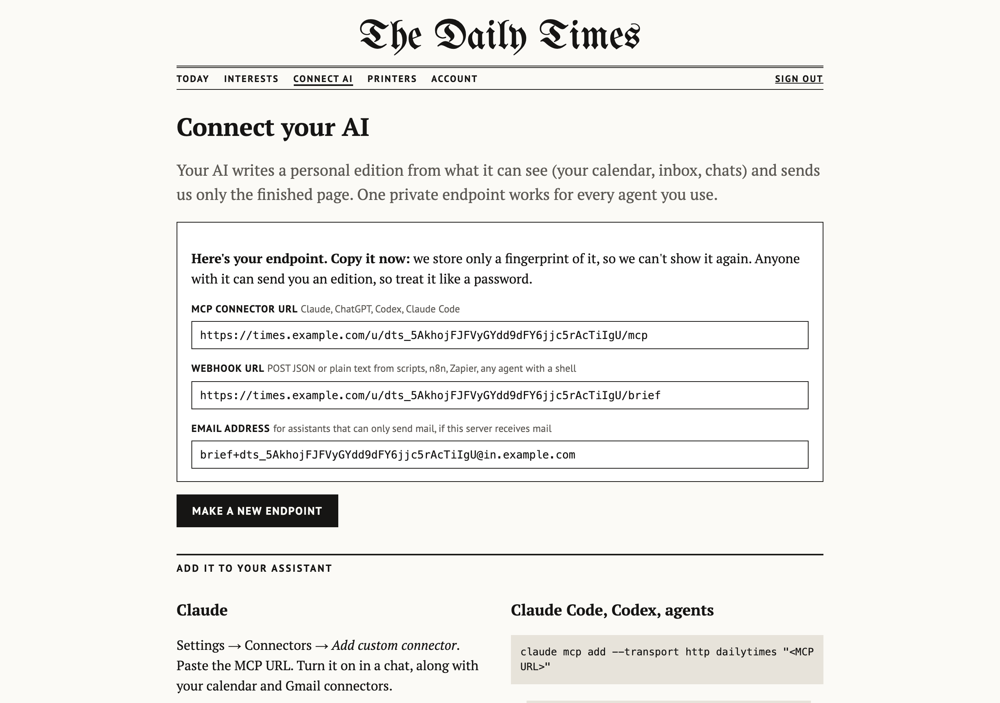

<div align="center">



# The Daily Times

**Your AI writes a one-page newspaper about your day.<br>It prints on any printer you own, when you walk up to it.**

[](LICENSE)
[](pyproject.toml)
[](#connect-any-ai-agent)
[](https://github.com/prasanthsasikumar/dailytimes/actions/workflows/tests.yml)
[](https://times.flowsxr.com)

[**Try it**](https://times.flowsxr.com) · [How it works](#how-it-works) · [Connect your AI](#connect-any-ai-agent) · [Any printer](#any-printer) · [Self-host](#run-your-own) · [Privacy](#privacy)

</div>

---

Every morning you pick up your phone and get dragged into a dozen feeds. The Daily Times
gives you one page instead: today's calendar, the emails that need you, what moved in your
field, new papers, jobs, prices and the weather. On paper, waiting at the printer.

- **Works without any AI.** Sign up, write one sentence about what you're into, and every
  morning you get an *auto edition* from public sources, with headlines and numbers quoted
  exactly as published.
- **Better with your AI.** Point Claude, ChatGPT, Codex, Claude Code or any agent at your
  private endpoint. It writes a *personal edition* from what only it can see (your calendar,
  your inbox, your chats) and sends just the finished page.
- **Any printer.** 58/80 mm receipt printers, office lasers, inkjets, IPP Everywhere,
  email-to-print, cheap Bluetooth "cat" printers, or no printer at all (open the PDF).
- **Prints when you walk up.** A tiny agent on a Raspberry Pi or Mac waits for a motion
  sensor, a button or a phone tap, then prints once a day.
- **Private by design.** We never see your calendar or mail. We keep an email, your interests
  and 30 days of editions. Export or delete everything in one click. Open source, MIT.

<p align="center"></p>
<p align="center"><sub>One layout engine, any paper: 58 mm and 80 mm receipts (crisp 1-bit raster), A4 and Letter (vector PDF, filled to exactly one page). All sample content is fictional.</sub></p>

## How it works



1. **06:00**: your AI's daily task gathers your day and calls `print_brief`. If no AI sends
   anything, the server builds an auto edition from your interests.
2. **07:40**: you walk past the printer. The sensor fires, the agent fetches today's edition,
   renders it for that exact printer, and prints it.
3. It reports back, so it prints once per day per printer, and stories you've already seen
   don't come back for 60 days.

## Get started

### Sign up (one minute)

Go to **[times.flowsxr.com](https://times.flowsxr.com)**, enter your email, describe what
you're into in a sentence. You'll see today's front page right away and can open it as a PDF.

<table>
<tr>
<td width="50%"><br><sub>Sign up with just an email.</sub></td>
<td width="50%"><br><sub>One sentence becomes topics, subreddits, tickers, papers and weather. Edit anything.</sub></td>
</tr>
<tr>
<td><br><sub>Today's edition, as PDF (A4, Letter) or receipt image.</sub></td>
<td><br><sub>Pair a printer with a one-time code.</sub></td>
</tr>
</table>

### Connect any AI agent

On **Connect AI** you get one private URL. It can only *add* editions to your paper: it can't
read anything back, and you can replace it at any time.

```bash
# Claude Code
claude mcp add --transport http dailytimes "https://times.flowsxr.com/u/<your-token>/mcp"
```

- **Claude** (web/desktop): Settings → Connectors → *Add custom connector* → paste the URL.
- **ChatGPT**: Settings → Apps & Connectors → developer mode → *Create* → paste the URL.
- **Codex**: `[mcp_servers.dailytimes] url = "<URL>"` in `~/.codex/config.toml`.
- **Anything else** (n8n, Zapier, cron, a shell script): `POST` JSON or plain text to the webhook URL.

Then paste the prompt from the page (also in [SETUP_PROMPT.md](SETUP_PROMPT.md)). It sets up a
daily task with strict editorial rules: concrete facts only, never invent, one source link per
item, short.

<p align="center"></p>

### Print it

On a Raspberry Pi, Mac or Linux box next to the printer:

```bash
pipx install "dailytimes[escpos,mdns] @ git+https://github.com/prasanthsasikumar/dailytimes"
dailytimes setup --server https://times.flowsxr.com --code ABCD-EFGH   # code from the Printers page
dailytimes service    # prints the systemd/launchd file to start it at boot
```

`setup` finds your printers (CUPS queues, Bonjour/IPP Everywhere, USB and serial receipt
printers), suggests the right paper, prints a test page and writes the config. No sensor?
The default trigger is a local URL, so an iOS Shortcut, an NFC tag or a smart button can say
"I'm here".

## Any printer

The server stores layout blocks, never pixels; each printer renders for its own paper. A new
printer type is one adapter class plus one profile file.

| profile | for | output |
|---|---|---|
| `thermal-58mm` | 58 mm receipt printers, cat printers (384 dots) | 1-bit raster, slip layout |
| `thermal-80mm` | 80 mm receipt printers (576 dots), cutter | 1-bit raster, slip layout |
| `a4` / `letter` | laser/inkjet via CUPS, IPP, email | PDF, two-column newspaper |
| `a5` | A5 or A4 folded | PDF, one column |
| `receipt-80mm-pdf` | thermal printers with a CUPS driver | receipt-length PDF |

`dailytimes profiles` lists them. Write your own YAML in `~/.config/dailytimes/profiles/`:

```yaml
name: thermal-104mm
type: thermal            # thermal (raster) | page (PDF)
layout: slip             # slip | newspaper
dpi: 203
paper_width_mm: 112
printable_width_px: 832
margins_mm: [4, 2, 6, 2] # top right bottom left
cutter: true
color: false
columns: 1
font_scale: 1.0
fill_page: false         # page profiles: scale type 0.85x-1.3x so the brief fills exactly one page
```

| adapter | options | takes |
|---|---|---|
| `cups` | `printer` (queue) or `uri` (`ipp://host/ipp/print`, driverless), `copies`, `lp_options` | PDF |
| `escpos` | `connection: usb\|serial\|network`, `vendor_id`/`product_id`, `device`/`baudrate`, `host`/`port` | raster |
| `catprinter` | `address`, `energy` (BLE transport is a stub, see [docs/cat-printers.md](docs/cat-printers.md)) | raster |
| `email` | `to`, `smtp_host`, `smtp_port`, `username`, `password_env`, `from_addr` | PDF |
| `file` | `directory`, `formats: [pdf, png]`, `name` | either |

Every adapter has a dry-run mode (`--dry-run`, or `dry_run: true` per output) that does all the
encoding (lp command, IPP request, ESC/POS bytes, MIME message) without touching hardware.

**Adding a printer type**: subclass `dailytimes.adapters.Adapter`, set `name` and `formats`,
implement `send(job)`, and either decorate it with `@register` or expose it in the
`dailytimes.adapters` entry-point group of your own package. Add a profile YAML. Nothing else changes.

### Presence: printing when someone walks up

| backend | hardware | options |
|---|---|---|
| `manual` | none: phone shortcut, smart button, `dailytimes presence`; optional GPIO push button | `host`, `port`, `button_pin` |
| `gpio` | PIR (HC-SR501, AM312) or mmWave (LD2410 OUT) on a Pi pin | `pin`, `active_high`, `pull_up`, `bounce_ms`, `hold_seconds` |
| `simulated` | none: Enter key or a timer | `stdin`, `every_seconds` |
| `ble` | phone/tag proximity via RSSI (stub, needs `bleak` and a stable advertiser) | `name`/`address`, `rssi_threshold` |

Rules: print once per day, on the first presence after `print_after`; at most one attempt per
`cooldown_minutes`; if no brief has arrived, `retry` later (default) or after `fallback_after`
print a `placeholder` slip / `skip` the day. The agent reports `printed`/`failed` to the relay.

## Privacy

The Daily Times is built to know as little as possible:

| we keep | we never see |
|---|---|
| your email (for sign-in links, no passwords) | your calendar, mail, chats or files: your AI reads those on its side |
| your interests and a city for weather | your location, contacts or browsing |
| editions for **30 days**, seen links for **60 days** | analytics, trackers, ads, third-party scripts |
| tokens only as **SHA-256 hashes** | anything we'd sell: we sell nothing |

Auto editions are built server-side from keyless public sources (Google News search, Hacker
News, Reddit, arXiv, Yahoo Finance, Open-Meteo, your RSS feeds). Nothing is summarised by an
LLM, so nothing can be made up. Full details: [PRIVACY.md](PRIVACY.md).

## Run your own

Everything above is this repository. Run the whole thing on your laptop, a Pi, a VPS, or
Vercel + Supabase:

```bash
git clone https://github.com/prasanthsasikumar/dailytimes && cd dailytimes
uv venv && uv pip install -e ".[dev]"
DAILYTIMES_DEV=1 .venv/bin/dailytimes serve        # http://localhost:8787, sign-in link shown on screen
```

```bash
.venv/bin/pytest -q             # 156 tests
./scripts/demo.sh               # server + MCP + webhook + printer agent + presence -> ./out (58mm, 80mm, A4, Letter)
./scripts/test_postgrest.sh     # storage tests against real Postgres + PostgREST (Supabase's stack)
```

Docker, Vercel + Supabase, email and every setting: [DEPLOY.md](DEPLOY.md) and [.env.example](.env.example).

## FAQ

**Do I need a printer?** No. The dashboard shows today's edition and opens it as a PDF. Many
people start by printing the PDF on whatever they have.

**Do I need an AI subscription?** No. The auto edition works on its own. Connecting an AI adds
the parts only it can see: your calendar, inbox and judgement about what matters.

**Which receipt printer should I buy?** Any ESC/POS printer works: 80 mm models with a cutter
(Epson TM-T20, Xprinter XP-80) feel the most like a newspaper; 58 mm ones are cheaper. Run
`dailytimes printers` to see what's detected.

**Can it print at a fixed time instead of on presence?** Yes: the `simulated` presence backend
with `every_seconds`, or a cron job calling `dailytimes presence`.

**Two printers?** Pair both. Each prints the day's edition once.

**Can my AI invent things?** The tool tells it not to, every item carries a source link, and
the page shows it. The auto edition can't invent: it only quotes sources.

## Developers

### The brief format

```json
{
  "title": "Thursday briefing",
  "blocks": [
    {"type": "heading", "text": "Today"},
    {"type": "row", "left": "09:30 Design review", "right": "Room 4"},
    {"type": "heading", "text": "Your field"},
    {"type": "heading", "level": 2, "text": "Lead story headline"},
    {"type": "text", "text": "One or two sentences.", "url": "https://source.example/story"},
    {"type": "bullet", "text": "One item.", "url": "https://source.example/item"},
    {"type": "divider"},
    {"type": "qr", "url": "https://source.example/story", "caption": "Read more"},
    {"type": "small", "text": "Sources: calendar, arXiv."}
  ]
}
```

Strict validation: unknown fields or types are rejected, URLs must be absolute http(s), there
are length limits per block, and at most 80 blocks and 6000 characters. The webhook and email
also accept plain text: `# Heading`, `## Headline`, `- bullet https://link`, `left | right`,
`---`, `qr: URL caption`, `small: text`, anything else is a paragraph.

### API

| method | path | auth | |
|---|---|---|---|
| POST | `/u/{token}/mcp` (also `/mcp` + Bearer or `?token=`) | endpoint token | MCP streamable HTTP, one tool: `print_brief` |
| POST | `/u/{token}/brief` (also `/v1/briefs` + Bearer) | endpoint token | webhook: JSON brief, or `text/plain` with optional `X-Brief-Title` |
| POST | `/v1/inbound/email` | `X-Inbound-Secret` | raw RFC 822 from your mail provider; recipient `brief+<token>@domain` |
| POST | `/v1/pair` | pairing code | `{code}` → printer token |
| GET | `/v1/device/brief` | printer token | today's edition for this printer, or 204 (builds the auto edition if due) |
| POST | `/v1/device/briefs/{id}/status` | printer token | `{status: printed\|failed, detail}` |
| GET | `/v1/device`, `/v1/device/history` | printer token | printer info, seen-link history |
| POST | `/v1/devices` | admin token | headless account + printer + endpoint |
| GET | `/cron/daily` | `CRON_SECRET` | pre-build auto editions, apply retention |

The **endpoint token** can only add editions; the **printer token** can only read today's
edition and report its own status. Both are stored hashed.

Send responses include `status` (`queued`, `duplicate`, `empty_after_dedup`),
`dropped_duplicates` (links already printed in the last 60 days) and `superseded`.

### Code map

```
src/dailytimes/
  blocks.py            brief schema, strict validation, link canonicalisation, plain-text parser
  relay/               the server: app (API), web (website), store, db (SQLite | Supabase),
                       mcp_server, sessions, mailer, autoedition, inbound email, templates/
  autobrief/           interests, public sources, composer, source suggestion, SSRF-safe fetch
  render/              profiles, bundled fonts (OFL), layout engine, raster + PDF renderers
  adapters/            cups+ipp, escpos, catprinter, email, file, discovery
  agent/               printer agent: config, rules, presence, runner, setup wizard
  cli.py               dailytimes serve|register|send|setup|service|agent|presence|printers|test-print|render|...
api/index.py           Vercel entry point          supabase/schema.sql   database schema (+ RLS)
scripts/               demo.sh, test_postgrest.sh  deploy/               example agent config, unit files
```


## Roadmap

- [ ] OAuth for the MCP connector (today the private URL is the credential)
- [ ] Publish to PyPI (`pipx install dailytimes`)
- [ ] Bluetooth transport for cat printers (the encoder is done: [docs/cat-printers.md](docs/cat-printers.md))
- [ ] E-ink displays as an output (the raster renderer already does any width)
- [ ] PWG raster for IPP printers that don't take PDF
- [ ] More sources for the auto edition: local events, transit, sports fixtures

Ideas and pull requests welcome: see [CONTRIBUTING.md](CONTRIBUTING.md). Design decisions are
logged in [PROGRESS.md](PROGRESS.md).

## License

MIT. Fonts: UnifrakturMaguntia and the PT family, under the SIL Open Font License.
